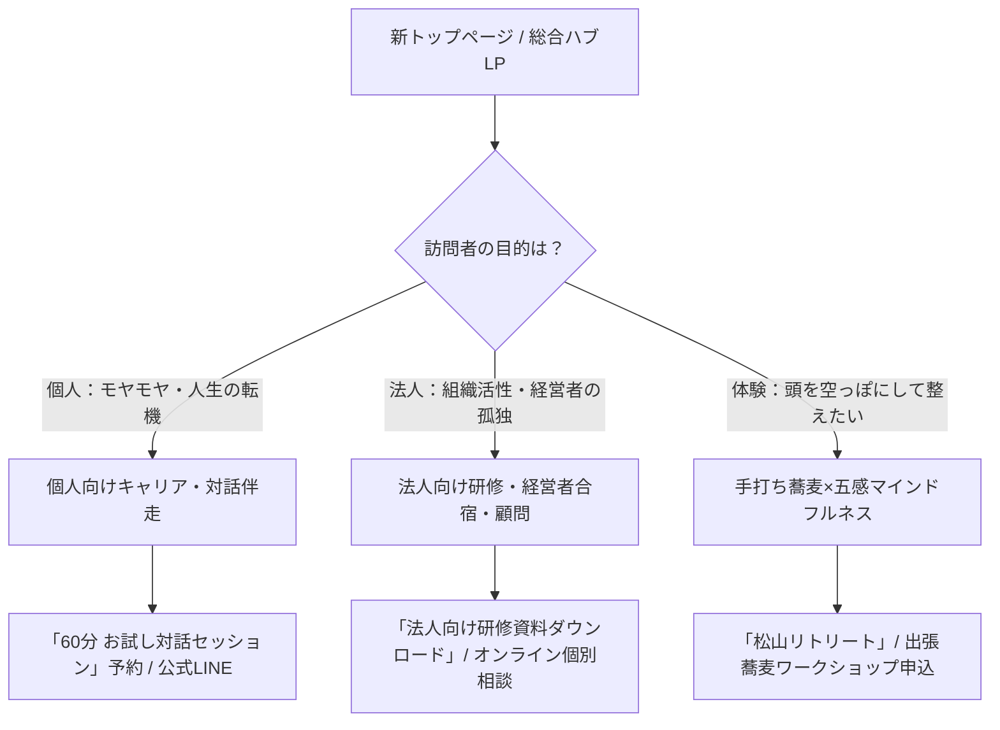

# 🌐 菊池 伸哉（きくりん）公式サイト リニューアル＆導線改善計画書

> **対象サイト**: [ライフ＆キャリアシェルパ 公式サイト (lifesherpasin.com)](https://lifesherpasin.com/)  
> **策定日**: 2026年10月31日  
> **目的**: 「対話」×「五感（蕎麦打ち）」の独自性を最大化し、個人向け・法人向け双方のCV（成約・問い合わせ）を高め、年商3,000万円モデルを実現するWebサイト基盤の構築。

---

## 1. 現行サイトの現状分析とリニューアルの課題

### 🔍 現行サイト（lifesherpasin.com）の現状
1. **メッセージの良さと安心感**:
   * 「在り方をととのえ、行動につなげる」「登る山・答えは自分の中にある」「安心安全なシェルパ」という温かい人柄と哲学がしっかり伝わっている。
   * 「SOBA（そば打ち体験）」と「対話（キャリア相談）」の両輪が提示されている。
2. **課題点・改善の余地**:
   * **導線の混在とファネルの不明瞭さ**:
     * 訪問者が「個人向け相談」「企業研修・法人顧問」「そば打ち体験」のどれを求めて来たのかによって次のアクション（CTA）が分散している。
   * **事業ポテンシャル（高単価化）の表現不足**:
     * 経営者合宿やチームビルディング、定期巡回シェルパ（月額15〜25万）など、BtoBの高付加価値オファーがサイト上であまり見えず、低単価・単発サービスに見えやすい。
   * **五感体験（蕎麦打ち）と対話の関係性の言語化**:
     * 「なぜキャリア支援の人が蕎麦を打つのか？」というUSP（独自の強み）の必然性が、初めて訪れた人にも一瞬で腹落ちするビジュアル＆コピーの強化が必要。
   * **CV（成約）への導線**:
     * 無料相談やLINE登録、体験会予約へのクリック導線が記事の奥にあり、モバイル閲覧時の離脱が懸念される。

---

## 2. 新サイトの全体アーキテクチャ＆導線設計

### 🧭 ターゲット別・導線分離（2大動線＋体験型フック）

---

## 3. サイトマップ（推奨構成）

| 階層 | ページ名 | 役割・掲載コンテンツ | 主なCTA |
| :--- | :--- | :--- | :--- |
| **Top** | **総合トップページ（ハブ）** | ・メインビジュアル（心と五感をととのえるシェルパ） ・共感ストーリー＆菊池伸哉の原体験 ・3つの入口（個人／法人／蕎麦リトリート） ・お客様の声＆メディア掲載 ・新着ブログ/note | 無料相談 / LINE登録 / 資料請求 |
| **Service 1** | **個人向け ライフ＆キャリア伴走** | ・「在り方×言葉×行動」をととのえる6ヶ月伴走 ・マンダラエンディングノート®ワークショップ ・料金プラン＆ステップ（お試し→継続伴走） | 60分お試しセッション予約 |
| **Service 2** | **法人向け 研修・合宿・組織開発** | ・経営者・幹部向け 五感調律リトリート合宿 ・蕎麦打ちチームビルディング研修 ・中小企業向け「外部巡回シェルパ（月額顧問）」 | 法人向けサービス概要PDF請求 / Zoom相談 |
| **Service 3** | **手打ち蕎麦×マインドフルネス** | ・五感を開いて頭を緩める「SOBAセラピー」 ・道後・松山リトリート案内 ・全国出張蕎麦打ちイベント案内 | リトリート先行予約 / 出張依頼 |
| **About** | **プロフィール（菊池 伸哉の歩み）** | ・食品メーカー〜蕎麦職人〜対人恐怖克服〜独立の軌跡 ・保有資格（キャリコン、産業カウンセラー、LCWコーチ等） ・「大丈夫、すべてうまくいっている」に込めた想い | メルマガ・公式LINE登録 |
| **Voice** | **お客様の声・実績** | ・個人の人生が変わったリアルな体験談 ・導入企業の人事・経営者の推薦文 ・開催風景の写真ギャラリー | 各種申込み |
| **Contact** | **お問い合わせ・お申込み** | ・法人・個人・取材・登壇用の総合問い合わせフォーム | 送信ボタン |

---

## 4. 各主要セクションのワイヤーフレーム詳細

### ① ファーストビュー（First View）
* **キャッチコピー**:  
  **「五感をととのえ、心をひらく。  
  答えはすべて、あなたの中にある。」**
* **サブコピー**:  
  元蕎麦職人 × 国家資格キャリアコンサルタント・産業カウンセラー。  
  頭で考える前に、身体と心をゆるめる唯一無二のライフ＆キャリア伴走。
* **背景/ビジュアル**:  
  きくりん氏の穏やかな笑顔 ＋ 蕎麦打ちの美しい手元・静謐な自然風景。
* **アクションボタン（2つ並列）**:
  1. `[個人のご相談（お試し対話）]`（オレンジ系アクセント）
  2. `[法人向け研修・合宿のご案内]`（ネイビー・シック）

### ② 共感・問題提起（Problem）
* 「仕事、キャリア、人生の転機。正解を探すほど、自分の本音が分からなくなっていませんか？」
* 「頭だけで考えてぐるぐる悩む日々に、必要なのは『知識』ではなく、まず『心をゆるめてととのえること』です。」

### ③ きくりんのアプローチ・USP（Solution）
* **「なぜ、蕎麦打ち × 対話なのか？」**
  * Step 1【五感解放】：粉に触れ、香りを嗅ぎ、手先を動かすことで脳の過緊張をゼロにする。
  * Step 2【深層対話】：心がほどけた状態で、問いを投げかけ、自分の本当の願いを掬い上げる。
  * Step 3【納得行動】：他人の正解ではなく、自分が心底納得した一歩を共に決める。

### ④ 3つのサービスカード（Services）
* カード1：【個人】ライフ＆キャリア伴走・対話セッション（60分体験〜継続）
* カード2：【法人】五感調律チームビルディング研修・経営者リトリート
* カード3：【体験】松山SOBAリトリート＆全国出張手打ち蕎麦ワークショップ

### ⑤ 信頼性・プロフィール（Authority / Profile）
* 25年間の会社員経験、挫折と対人不安の克服、蕎麦職人修行。
* 資格一覧バッジ（国家資格キャリアコンサルタント、産業カウンセラー、LCWプロコーチ等）。

### ⑥ お客様の声（Social Proof）
* 30〜50代ビジネスパーソンの生の声、経営者の感想、写真付きで安心感を演出。

### ⑦ フッター・クロージングCTA（Final Action）
* 「大丈夫！すべてうまくいっている」の手書き風サイン。
* 無料相談予約カレンダー / LINE友だち追加ボタン。
