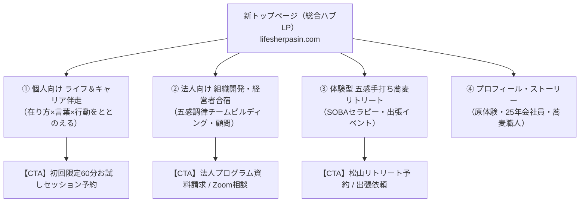

# 📄 公式Webサイト リニューアル＆売上最大化 戦略提案書
## 「在り方をととのえる」から「選ばれ、成約につながる」Web基盤への進化

**クライアント**: ライフ＆キャリアシェルパ 菊池 伸哉（きくりん）様  
**提案日**: 2026年10月31日  
**プロジェクト名**: 公式サイト（lifesherpasin.com）全面リニューアル＆成約導線構築プロジェクト  

---

## 1. エグゼクティブサマリー（提案の骨子）

菊池伸哉様が展開されている「ライフ＆キャリアシェルパ」の活動は、**「国家資格キャリアコンサルタント・産業カウンセラーとしての確かな対話力」**と**「元蕎麦職人としての身体性・五感マインドフルネス体験」**という、日本全国を見渡しても唯一無二の強いUSP（独自の強み）を持っています。

しかし、現在の公式ホームページ（lifesherpasin.com）は、菊池様の温かい哲学や想いが伝わっている一方で、**「訪問者が次に何をすべきか（成約導線）」が不明瞭**であり、特に事業収益の大きな柱となり得る**高単価な法人事業（経営者合宿・チームビルディング・外部巡回顧問）のオファーが十分に表現されていません**。

本プロジェクトでは、現在のサイトが持つ「温かさと哲学」を100%継承しながら、**「個人向け伴走」「法人向け組織開発」「五感蕎麦リトリート」の3大動線を完全確立**し、**労働時間を抑えながら年商3,000万円（月商250万円）を安定構築できるWeb基盤**へと生まれ変わらせることを提案いたします。

---

## 2. 現状サイト（lifesherpasin.com）の分析と課題の棚卸し

| 観点 | 現行サイトの評価（強み） | 改善すべき重要課題（ボトルネック） |
| :--- | :--- | :--- |
| **ブランディング** | ・「シェルパ（道先案内人）」「在り方をととのえる」という優しい人柄と世界観が伝わっている。 | ・「なぜキャリア支援の人が蕎麦を打つのか？」という掛け算の必然性が一目で直感的に伝わりにくい。 |
| **ターゲット導線** | ・ブログ記事や各種案内が網羅されている。 | ・「個人」「企業の人事」「経営者」「蕎麦体験希望者」の入口が混在し、訪問者が迷子になりやすい。 |
| **マネタイズ・収益性** | ・単発のセッションや体験の案内がある。 | ・月額15万〜25万円の企業顧問や、30万〜60万円のチームビルディング合宿といった高単価オファーが埋もれている。 |
| **成約率（CVR）** | ・問い合わせフォームが存在する。 | ・「60分お試し対話セッション」「研修資料ダウンロード」など、ハードルの低い具体的な行動喚起（CTA）が弱い。 |

---

## 3. リニューアルの基本戦略（3大コアコンセプト）

### 戦略①：唯一無二のUSP「五感（身体）× 対話（心）」の言語化とビジュアル化
「頭だけで考えて堂々巡りになっている現代人に、まず五感（蕎麦打ち）を開いて頭をゆるめ、そこから深層対話で本当の答えを導き出す」というストーリーをファーストビューで直感的に提示。競合する他のコーチやキャリアコンサルタントとの決定的な差別化を図ります。

### 戦略②：ターゲット別 2大動線（BtoC / BtoB）の完全分離
* **【個人向け（BtoC）】**: 人生の転機・職場のモヤモヤを抱える方へ → **「初回60分 お試し対話セッション」**または**「公式LINE登録」**へ誘導。
* **【法人・経営者向け（BtoB）】**: 心理的安全性や離職防止、リーダーの孤独を解決したい企業へ → **「法人研修・経営者合宿 プログラム資料PDF請求」**へ誘導。

### 戦略③：年商3,000万円ポートフォリオを支えるサービス構造の反映
先日策定した収益構造（法人顧問、チームビルディング合宿、個人継続伴走、松山リトリート）をWeb上にわかりやすく可視化し、安売り・単発労働から「高付加価値・高単価・ストック型」へのシフトをWeb上で完成させます。

---

## 4. 新サイト アーキテクチャ＆サイトマップ



### 階層別ページ設計と役割
1. **トップページ（総合ハブLP）**:
   * ファーストビューで圧倒的な安心感と独自性を提示。
   * 「3つのアプローチ」から訪問者を各専用ページへスムーズに誘導。
2. **法人特化LP（BtoB専用）**:
   * 経営陣向けリトリート合宿（60万〜120万円）、蕎麦打ち研修（35万〜60万円）、外部巡回顧問（月額15万〜25万円）の具体的な導入メリットと料金目安を明記。
3. **個人伴走LP（BtoC専用）**:
   * 批判のない安全な対話空間、マンダラエンディングノート®、3ヶ月〜6ヶ月継続伴走へのステップを解説。

---

## 5. 成約率（CVR）を最大化するファネル設計

訪問者の心理的ハードルを段階的に下げ、自然に成約へとつなげる2系統のファネルを構築します。

```
【個人向けファネル】
Web訪問・SNS（note/Instagram）
   ↓
トップページ（共感・安心感の獲得）
   ↓
【無料〜低額フック】：公式LINE登録特典 / 初回60分お試し対話セッション（3,000円〜無料）
   ↓
【本命商品】：ライフ＆キャリア継続伴走プログラム（3ヶ月〜6ヶ月 / 15万〜30万円）

--------------------------------------------------------------------------------

【法人向けファネル】
Web訪問・ご紹介・代表経由
   ↓
法人特化LP（課題提起・事例・産業カウンセラーとしての信頼性）
   ↓
【低ハードルフック】：研修プログラム概要PDFダウンロード / 30分オンライン無料診断
   ↓
【本命商品】：チームビルディング研修（35万〜） / 経営者合宿（60万〜） / 外部顧問契約（月額20万）
```

---

## 6. プロジェクト実施ステップ＆スケジュール

本リニューアルは、既存のWordPress環境（Lightningテーマ等）を活用、または新規モダンLPを組み込む形で、スムーズに移行可能です。

| フェーズ | 期間目安 | 主なタスク・実施内容 |
| :--- | :--- | :--- |
| **Phase 1: 戦略・原稿確定** | 1週目 | ・今回作成したコピーライティング資産（`website_copywriting_assets.md`）の最終確認<br>・掲載写真（きくりん様の高解像度ポートレート）の選定 |
| **Phase 2: デザイン・コーディング** | 2週目 | ・完成済み新トップLP（`website_new_landing_page.html`）の実装調整<br>・法人向け専用LP（`service_corporate_lp.html`）の連動 |
| **Phase 3: フォーム・計測設定** | 3週目 | ・予約カレンダー（TimeRex/Spir等）連携<br>・公式LINE誘導バナー、問い合わせフォームの疎通テスト<br>・Google Analytics / サーチコンソール設定 |
| **Phase 4: 公開・運用開始** | 4週目 | ・lifesherpasin.com 本番公開<br>・note・Instagram・Facebookでのリニューアル告知・集客開始 |

---

## 7. 期待される成果と投資対効果（ROI）

1. **問い合わせ件数の倍増（CVRの向上）**:
   * 曖昧だった導線が「個人お試しセッション」「法人資料請求」に一本化されることで、離脱を防ぎ、月間の新規リード獲得数を2〜3倍に引き上げます。
2. **高単価BtoB案件の自然受注**:
   * 法人向けサービスが明確になることで、「経営者仲間からの紹介」「企業の研修担当者からの直接問い合わせ」が生まれ、1案件あたり30万〜60万円のまとまった売上が発生します。
3. **ブランド価値の確立と安心感**:
   * 和モダンの洗練されたデザインと「大丈夫！すべてうまくいっている」の温かいメッセージが融合し、全国から選ばれるトップランナーとしてのポジションを確立します。

---

### 📎 本提案書の付属資料（ローカル保存済み）
* 📘 **サイトリニューアル基本計画書**: `website_renewal_plan.md`
* ✍️ **実践コピーライティング原稿集**: `website_copywriting_assets.md`
* 💻 **新総合トップページ（実動HTML）**: `website_new_landing_page.html`
* 🏢 **法人特化LP（実動HTML）**: `service_corporate_lp.html`
