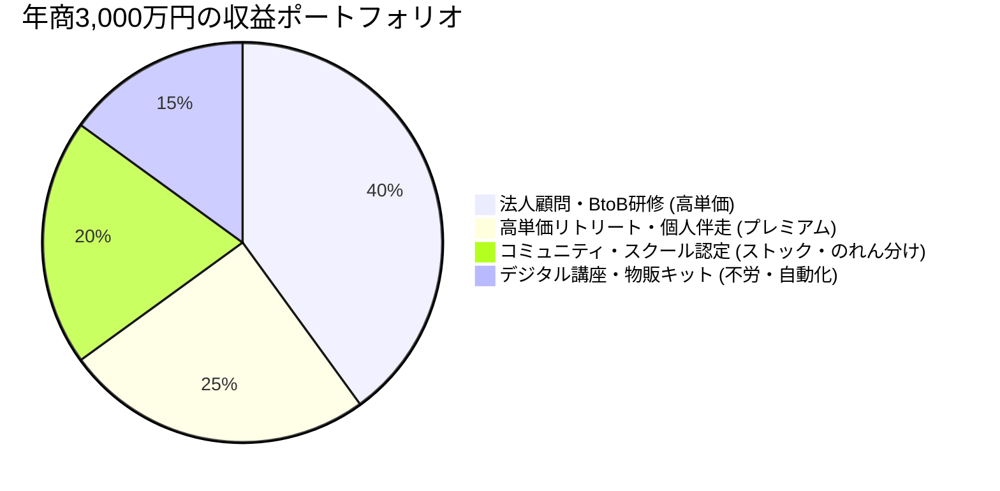
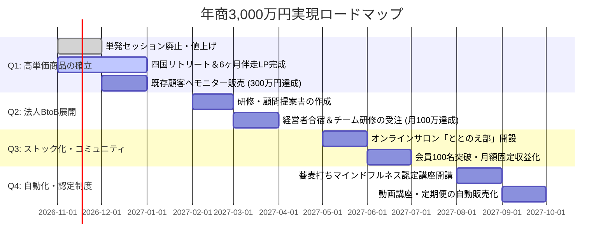

# 📊 きくりん専用：収益最大化ダッシュボード＆ビジュアルカードカタログ

> **コンセプト**: 「対話（心）」×「手打ち蕎麦（五感・身体）」の唯一無二の掛け算で、労働時間を減らしながら**年商3,000万円（月商250万円）**を安定構築する事業構造設計図。

---

## 🧭 【1画面でわかる】収益ポートフォリオ・ダッシュボード

### 🎯 目標年商 3,000万円（月商250万円）の構成比率



### 📈 4大エンジン別 収益シミュレーション一覧表

| エンジン名 | 主力商品・サービス | 想定客単価 | 月間販売数/稼働 | 月商目安 | 労働負荷 | スケール性 |
| :--- | :--- | :--- | :--- | :--- | :--- | :--- |
| **① BtoB・法人** | 企業顧問（巡回シェルパ）＋チームビルディング合宿 | 20万〜60万円 | 顧問3社＋研修2本 | **約100万円** | 🟡 中（月4日） | 🟢 高 |
| **② リトリート・伴走** | 四国松山リトリート＋6ヶ月継続コーチング | 25万〜35万円 | リトリート1回＋伴走3名 | **約65万円** | 🔴 高（月3日） | 🟡 中 |
| **③ ストック・認定** | オンラインサロン「ととのえ部」＋認定講師ライセンス | 3,300円 / 40万円 | 会員120名＋受講生隔月 | **約50万円** | 🟢 低（月1日） | 🟣 超高 |
| **④ 自動販売・物販** | 動画講座＋自宅蕎麦打ちキット＆そば粉定期便 | 3,000〜30,000円 | キット定期50件＋動画講座 | **約35万円** | 🟢 ゼロ〜極小 | 🟣 超高 |
| **【合計】** | — | — | **合計実働：月8〜9日** | **月商 250万円**<br>**(年商 3,000万円)** | 余裕のある<br>ライフスタイル | **高収益<br>体質完成** |

---

## 🗂️ ビジュアルカード型・収益ビジネスモデルカタログ

---

### ENGINE 1：🏢 高単価 BtoB・法人事業（安定と大口利益の柱）

```
┌─────────────────────────────────────────────────────────────────────────────────┐
│ 🏷️ CARD 01: 経営者・CXO向け「五感調律マインドフルネス合宿」                     │
├─────────────────────────────────────────────────────────────────────────────────┤
│ 🎯 ターゲット │ 激務・孤独・重圧に晒されるベンチャー経営者、2代目社長、役員陣   │
│ 💰 想定価格   │ 600,000円 〜 1,200,000円 / 1社（1泊2日・最大3名）               │
│ ⏱️ 労働負荷   │ 🔴 月1回（1泊2日）                                              │
│ 💡 収益構造   │ 道後温泉・松山古民家と提携。「雑念を断つ蕎麦打ち」＋「深層対話」│
│ 🚀 収益試算   │ 隔月1社受注 ＝ **月平均 30万〜50万円**                          │
│ ⭐ 独自の勝因 │ 「ただの座禅や旅行」ではなく「元職人の五感体験×プロコーチの対話」│
└─────────────────────────────────────────────────────────────────────────────────┘
```

```
┌─────────────────────────────────────────────────────────────────────────────────┐
│ 🏷️ CARD 02: 企業の五感解放型「チームビルディング・オフサイト研修」              │
├─────────────────────────────────────────────────────────────────────────────────┤
│ 🎯 ターゲット │ リモートワークで関係性が希薄化したIT企業、新体制キックオフ組織  │
│ 💰 想定価格   │ 350,000円 〜 600,000円 / 半日〜1日（10〜20名規模）              │
│ ⏱️ 労働負荷   │ 🟡 月1〜2回（半日）                                             │
│ 💡 収益構造   │ 全員で蕎麦を打って食べる（共同体験）→ 心理的安全性を最大化      │
│ 🚀 収益試算   │ 月1回開催 ＝ **月商 40万円**                                    │
│ ⭐ 独自の勝因 │ 座学のみの退屈な研修と違い、五感を刺激するため満足度・リピート率絶大 │
└─────────────────────────────────────────────────────────────────────────────────┘
```

```
┌─────────────────────────────────────────────────────────────────────────────────┐
│ 🏷️ CARD 03: 中小企業向け「顧問ライフ＆キャリアシェルパ」（定期巡回）             │
├─────────────────────────────────────────────────────────────────────────────────┤
│ 🎯 ターゲット │ 人事部・相談窓口がない社員30〜150名規模の中小企業               │
│ 💰 想定価格   │ 月額 150,000円 〜 250,000円 / 社（月1日訪問＋オンライン相談） │
│ ⏱️ 労働負荷   │ 🟢 低〜中（月1日訪問）                                          │
│ 💡 収益構造   │ 産業カウンセラー×キャリアコンサルタントの資格で離職防止・メンタル支援 │
│ 🚀 収益試算   │ 3社契約 ＝ **月額 50万円（毎月自動確定する強固なストック収入）** │
│ ⭐ 独自の勝因 │ 社内人事には言えない本音を受け止める「安心安全な第三者窓口」    │
└─────────────────────────────────────────────────────────────────────────────────┘
```

---

### ENGINE 2：🌄 高付加価値リトリート＆個人伴走（熱狂的ファンの確立）

```
┌─────────────────────────────────────────────────────────────────────────────────┐
│ 🏷️ CARD 04: 「人生再起動（Re-boot）リトリート in 四国」                         │
├─────────────────────────────────────────────────────────────────────────────────┤
│ 🎯 ターゲット │ 燃え尽き気味の会社員、キャリアに迷う40〜50代、セカンドライフ層  │
│ 💰 想定価格   │ 250,000円 / 1名（2泊3日・定員3名限定のプレミアム少人数制）      │
│ ⏱️ 労働負荷   │ 🔴 2ヶ月に1回（2泊3日）                                         │
│ 💡 収益構造   │ ライフシェルパ号で巡る自然散策＋そば打ち＋マンダラ人生棚卸し    │
│ 🚀 収益試算   │ 1回3名参加 ＝ 75万円（2ヶ月に1回開催で **月平均 37.5万円**）    │
│ ⭐ 独自の勝因 │ 「旅行」ではなく「人生の舵を取り戻す通過儀礼」としての価値設定  │
└─────────────────────────────────────────────────────────────────────────────────┘
```

```
┌─────────────────────────────────────────────────────────────────────────────────┐
│ 🏷️ CARD 05: 6ヶ月集中「自分との関係をととのえる」パーソナル伴走                │
├─────────────────────────────────────────────────────────────────────────────────┤
│ 🎯 ターゲット │ 自己肯定感の低さ、対人関係の悩み、独立準備に悩む個人            │
│ 💰 想定価格   │ 330,000円 〜 450,000円 / 6ヶ月（月2回セッション＋チャット相談） │
│ ⏱️ 労働負荷   │ 🟡 月数時間 / 人                                                │
│ 💡 収益構造   │ 単発セッションを廃止し、長期コミット型に一本化して結果を出させる│
│ 🚀 収益試算   │ 常時5〜6名が稼働中 ＝ **月商 約30万〜40万円**                   │
│ ⭐ 独自の勝因 │ 自身の劣等感・対人恐怖の克服ストーリーが唯一無二の共感を生む    │
└─────────────────────────────────────────────────────────────────────────────────┘
```

---

### ENGINE 3：🔄 ストック課金＆認定・のれん分け（レバレッジの拡大）

```
┌─────────────────────────────────────────────────────────────────────────────────┐
│ 🏷️ CARD 06: オンラインサロン「ととのえ部」                                     │
├─────────────────────────────────────────────────────────────────────────────────┤
│ 🎯 ターゲット │ 日常のストレスをリセットしたい人、きくりんのファンコミュニティ  │
│ 💰 想定価格   │ 月額 3,850円（税込）                                            │
│ ⏱️ 労働負荷   │ 🟢 低（週1回の問い配信＋月1回オンラインZoom交流会）             │
│ 💡 収益構造   │ 「魔法の質問」と「大丈夫の言霊」で日々の心の波をととのえる場    │
│ 🚀 収益試算   │ 会員130名 ＝ **月額 50万円（固定費をすべて賄うベース収入）**     │
│ ⭐ 独自の勝因 │ 高度な講義ではなく「帰ってこられる心のオアシス」としての場づくり│
└─────────────────────────────────────────────────────────────────────────────────┘
```

```
┌─────────────────────────────────────────────────────────────────────────────────┐
│ 🏷️ CARD 07: 「そば打ちマインドフルネス®」認定ファシリテーター養成講座           │
├─────────────────────────────────────────────────────────────────────────────────┤
│ 🎯 ターゲット │ 地域のコミュニティリーダー、コーチ、ウェルネス系講師            │
│ 💰 想定価格   │ 受講料 440,000円 ＋ 認定ライセンス・更新料 月額 5,500円         │
│ ⏱️ 労働負荷   │ 🟡 年2回開催（短期集中講座）                                    │
│ 💡 収益構造   │ 自分のメソッドを他者に伝授して全国展開。修了者は支部として活動  │
│ 🚀 収益試算   │ 1期5名受講 ＝ 220万円（年2回で440万円＋月額ライセンス料）       │
│ ⭐ 独自の勝因 │ 誰も真似できない「蕎麦×マインドフルネス」の商標・ブランド確立  │
└─────────────────────────────────────────────────────────────────────────────────┘
```

---

### ENGINE 4：📦 デジタル自動販売＆プロダクト物販（労働時間ゼロの収益）

```
┌─────────────────────────────────────────────────────────────────────────────────┐
│ 🏷️ CARD 08: 「こころととのう 自宅蕎麦打ちキット＆そば粉定期便」                 │
├─────────────────────────────────────────────────────────────────────────────────┤
│ 🎯 ターゲット │ 都会のワーカホリック層、丁寧な暮らしを求める層、リトリート参加者│
│ 💰 想定価格   │ スターターキット 19,800円 / そば粉定期便 月額 3,980円           │
│ ⏱️ 労働負荷   │ 🟢 ゼロ（発送代行・提携製粉所からの直送スキーム）               │
│ 💡 収益構造   │ 初心者向け解説動画＋厳選そば粉＋「打つ前の瞑想音声ガイド」      │
│ 🚀 収益試算   │ 定期購入者 50名 ＝ **月商 約20万円**                             │
│ ⭐ 独自の勝因 │ 食品メーカー商品開発経験を活かした「絶対に失敗しない粉の黄金比」│
└─────────────────────────────────────────────────────────────────────────────────┘
```

```
┌─────────────────────────────────────────────────────────────────────────────────┐
│ 🏷️ CARD 09: オンライン買い切り動画講座（Udemy / 自社プラットフォーム）          │
├─────────────────────────────────────────────────────────────────────────────────┤
│ 🎯 ターゲット │ あがり症・人前で緊張して話せないビジネスパーソン                │
│ 💰 想定価格   │ 19,800円 〜 38,000円                                            │
│ ⏱️ 労働負荷   │ 🟢 完全ゼロ（一度撮影・アップロードすれば自動販売）             │
│ 💡 収益構造   │ 「話し方の前に『自分との関係』をととのえる伝わる技術」          │
│ 🚀 収益試算   │ 月10〜15本販売 ＝ **月商 約15万〜25万円**                        │
│ ⭐ 独自の勝因 │ 話し方スクール認定講師の実績と、克服者ならではの具体的ステップ  │
└─────────────────────────────────────────────────────────────────────────────────┘
```

---

## ⚡ 【一目瞭然】顧客が自然に高単価へ進む「収益ファネル」

```
┌────────────────────────────────────────────────────────────────┐
│ ① 集客・認知（無料〜低価格）                                   │
│  ・Instagram / note / Voicy「大丈夫！ラジオ」                  │
│  ・出張蕎麦打ちイベント / 話し方体験セミナー（3,000〜5,000円）  │
└───────────────────────┬────────────────────────────────────────┘
                        │ 興味を持ったファンが参加
                        ▼
┌────────────────────────────────────────────────────────────────┐
│ ② 信頼構築・ベース収益（月額課金・キット）                     │
│  ・オンラインサロン「ととのえ部」（月額3,850円）                │
│  ・自宅蕎麦打ちキット＆そば粉定期便                            │
│  ・オンライン動画講座（19,800円）                              │
└───────────────────────┬────────────────────────────────────────┘
                        │ より深い変化を求める人がステップアップ
                        ▼
┌────────────────────────────────────────────────────────────────┐
│ ③ コア高単価プログラム（高利益・人生変革）                     │
│  ・四国松山リトリート（250,000円）                             │
│  ・6ヶ月パーソナル伴走コーチング（330,000円）                   │
│  ・認定ファシリテーター養成講座（440,000円）                   │
└───────────────────────┬────────────────────────────────────────┘
                        │ 経営者・企業が自社への導入を依頼
                        ▼
┌────────────────────────────────────────────────────────────────┐
│ ④ 法人向けウルトラハイエンド（大口収益）                       │
│  ・経営者向けマインドフルネス合宿（60万〜120万円）             │
│  ・企業チームビルディング研修（35万〜60万円）                   │
│  ・顧問ライフ＆キャリアシェルパ（月額15万〜25万円/社）         │
└────────────────────────────────────────────────────────────────┘
```

---

## 📅 【直感ロードマップ】年商3,000万円達成の4四半期アクション



---

## 💎 結論：なぜこのモデルなら「ゆとり」と「高年収」が両立するのか？

1. **実働日は月8〜9日のみ**:
   * 法人訪問（3日）＋ リトリート（2〜3日）＋ サロン・講座運営（2〜3日）で完結。
2. **価格競争から100%解放される**:
   * 「キャリアコーチ」なら1時間1万円で比較されますが、「蕎麦打ちで五感を解放し、人生の舵を取り戻す唯一のシェルパ」には定価が存在せず、きくりん氏の言い値で成立します。
3. **景気や労働に左右されないストックと自動収益**:
   * サロン月額＋企業顧問料＋キット定期便により、**「何もしなくても毎月100万円以上が入ってくる基盤」**ができるため、心に圧倒的なゆとりを持ちながら質の高い支援に専念できます。
